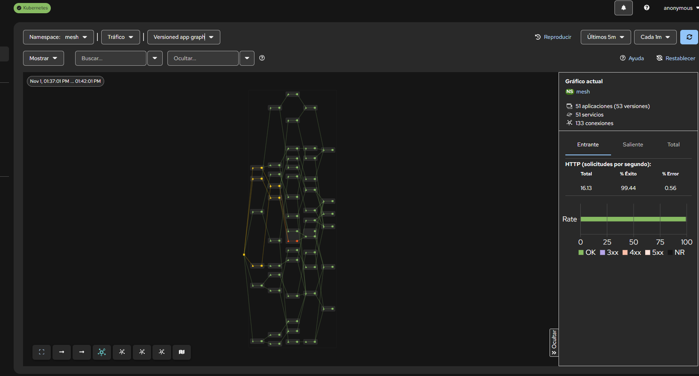
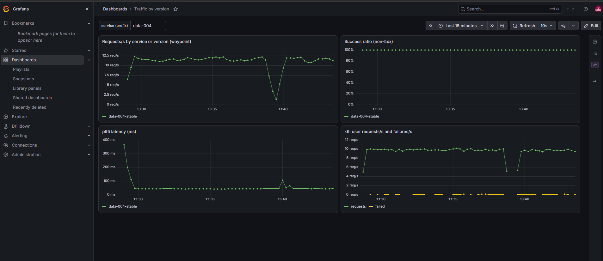
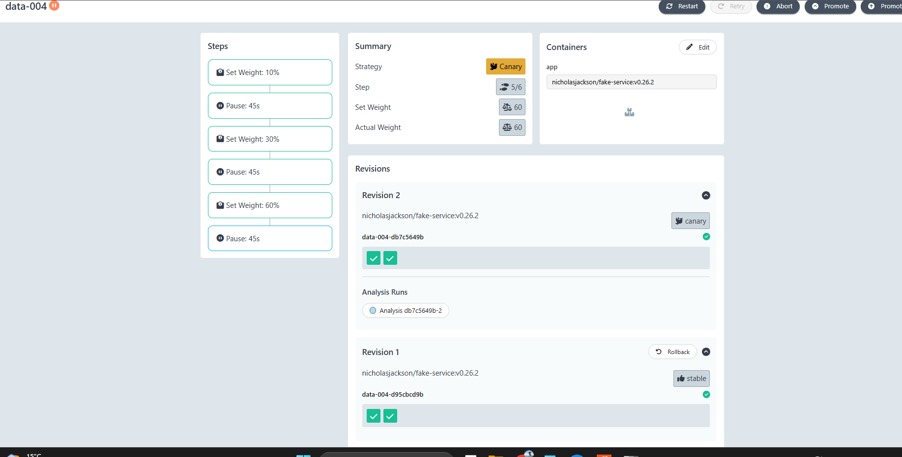
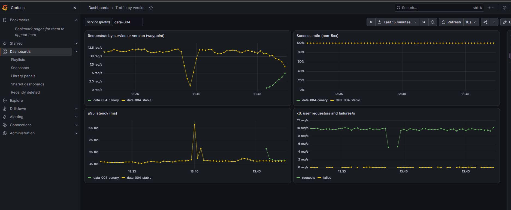
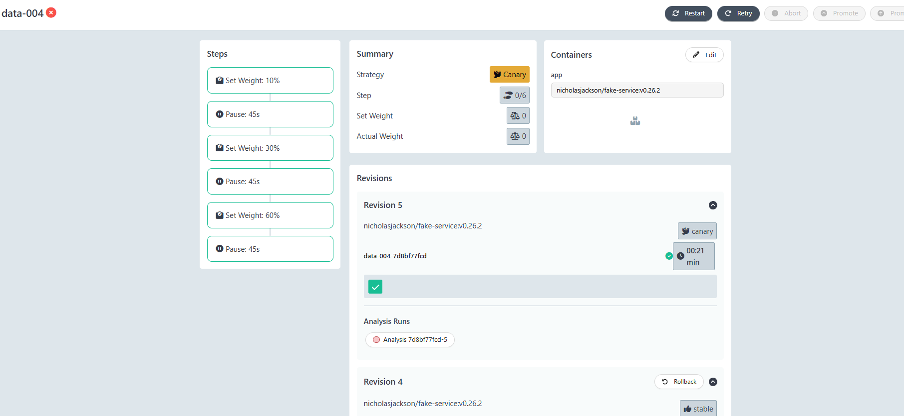
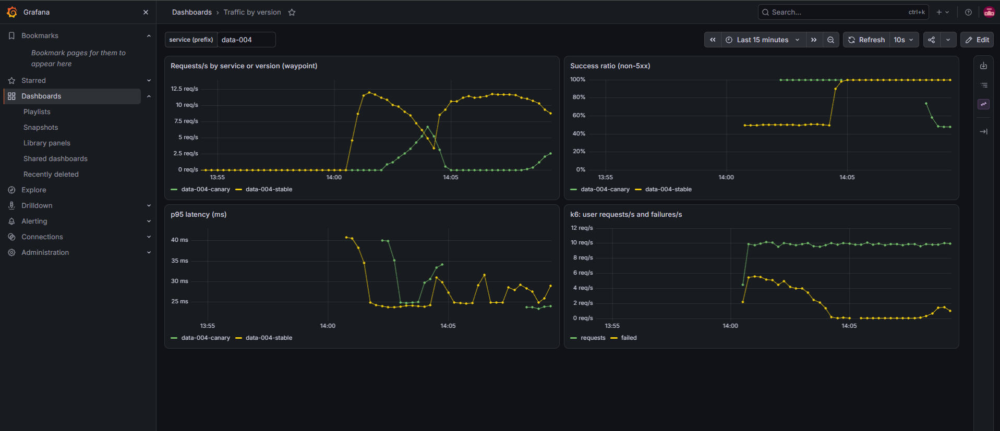

# mesh-lab

Laboratorio local para practicar **canary, A/B, mirroring y progressive delivery** y ver por dónde fluye el tráfico.
50-150 microservicios sin código (todos son la misma imagen `fake-service`) sobre kind + Istio ambient, con Argo Rollouts,
Prometheus/Grafana, Kiali, Tempo y k6.

> Informe con capturas y resultados reales: **[docs/LAB-REPORT.md](docs/LAB-REPORT.md)**

```
k6 (en el cluster) ──► fe-001..fe-0NN ──► api-* ──► biz-* ──► data-* ──► ext-*
                              todo el tráfico L7 pasa por 1 waypoint (Envoy) en el namespace `mesh`
                                   │
                  Prometheus ◄─────┤ métricas por servicio/versión (istio_requests_total)
                  Kiali      ◄─────┤ grafo de tráfico con % por arista
                  Tempo      ◄─────┘ trazas (fake-service ─Zipkin─► Tempo)
```

## Resultados

Capturas reales del laboratorio (50 servicios, 10 peticiones de usuario por segundo). El detalle de cada una está en el
[informe](docs/LAB-REPORT.md).

### 1. El tráfico fluye y se ve

<table>
  <tr>
    <td width="50%" valign="top">
      
      <br><sub><b>Kiali.</b> 51 aplicaciones, 133 conexiones y 99,44% de éxito. Cada arista es tráfico real entre servicios.</sub>
    </td>
    <td width="50%" valign="top">
      
      <br><sub><b>Grafana.</b> Línea base de <code>data-004</code>: ~12 req/s, 100% de éxito y p95 de ~45 ms.</sub>
    </td>
  </tr>
</table>

### 2. Canary bueno: el tráfico pasa poco a poco a la versión nueva

<table>
  <tr>
    <td width="50%" valign="top">
      
      <br><sub><b>Argo Rollouts.</b> Paso 5/6 con el 60% del tráfico en la revisión nueva y el análisis en curso.</sub>
    </td>
    <td width="50%" valign="top">
      
      <br><sub><b>Grafana.</b> La línea canary sube mientras la estable baja; el éxito y la latencia no cambian.</sub>
    </td>
  </tr>
</table>

### 3. Canary malo: se aborta solo

<table>
  <tr>
    <td width="50%" valign="top">
      
      <br><sub><b>Argo Rollouts.</b> La revisión con un 40% de errores fue abortada por el análisis; la revisión anterior sigue como estable.</sub>
    </td>
    <td width="50%" valign="top">
      
      <br><sub><b>Grafana.</b> El éxito de la canary cae por debajo del 95% y el tráfico vuelve a la versión estable sin intervención.</sub>
    </td>
  </tr>
</table>

## Requisitos (Windows + WSL2)

- Docker Desktop con ~9 GiB para WSL (`docker info | findstr "Total Memory"`). Se configura en `C:\Users\<tu usuario>\.wslconfig`:
  ```ini
  [wsl2]
  memory=9GB
  processors=14
  swap=4GB
  ```
  El fichero debe contener **solo eso**. Después: cerrar Docker Desktop, `wsl --shutdown` y reabrirlo.
- Todo se ejecuta **dentro de Ubuntu (WSL)**, no en PowerShell. Activa la integración de Ubuntu en Docker Desktop.
- Un `kubectl` actual (el de Docker Desktop puede ser muy antiguo): `which -a kubectl`.

## Arranque

```bash
make tools      # instala kind, kubectl, helm, envsubst
make up         # cluster + Istio ambient + Prometheus/Grafana + Tempo + Kiali + Argo Rollouts + k6-operator (~10 min)
make deploy N=50
make verify     # pods, waypoint, una petición real, métricas
make ui         # Grafana :3000 (admin/admin), Kiali :20001, Argo Rollouts :3100, Prometheus :9090  (deja la terminal ocupada)
make load SCENARIO=baseline RATE=10     # en otra terminal
```

Empieza con `N=50` y sube a 100 y luego a 150 vigilando `docker stats`. Con 9 GiB, 150 es el techo razonable.
Ejecuta `make help` para ver todos los targets.

## Qué hay en el grafo

`make generate N=100` escribe `generated/topology.yaml` (semilla fija → mismo grafo siempre) e imprime las
**llamadas internas por petición de usuario**. Importante: fake-service llama a *todos* sus upstreams en cada petición,
así que el fan-out se multiplica; el generador lo mantiene en 1-2 por servicio (~18-19 llamadas internas por petición).

El generador elige automáticamente, entre los servicios más transitados de las capas intermedias:

| Tipo | Qué se despliega | Para qué |
|---|---|---|
| `canary` (2 por defecto) | Argo Rollout + `-stable`/`-canary` + VirtualService | canary con análisis automático |
| `variants` modo `ab` | Deployments `-v1`/`-v2` + VirtualService por cabecera | A/B testing |
| `variants` modo `mirror` | igual, con shadow traffic a v2 | dark launch |
| resto | Deployment + Service | tráfico de fondo |

Los nombres elegidos salen al ejecutar `make generate` o `make deploy` (con `N=50` y semilla 42:
canary `data-004` y `data-002`, A/B `biz-012`, mirror `data-001`). Cambian si cambias `N` o `SEED`.

## Experimentos

**Importante:** el análisis del canary necesita tráfico. Sin tráfico el canary **no se aprueba**, así que lanza antes
`make load SCENARIO=baseline RATE=10` (dura 30 min) y comprueba que el pod `k6-baseline-1` está `Running`.

**Canary automático** (Argo Rollouts, pasos 10% → 30% → 60%, 45 s cada uno, análisis sobre Prometheus):

```bash
make canary-release SVC=data-004 VERSION=v2 ERR=0.0   # versión buena: se completa
make canary-release SVC=data-004 VERSION=v3 ERR=0.4   # versión mala: se aborta sola
```
Míralo en Argo Rollouts (:3100), Kiali y el dashboard "Traffic by version" de Grafana (escribe el servicio, p. ej. `data-004`).
Tras un aborto, Argo deja el Rollout en `Degraded`; no afecta al tráfico y se limpia con la siguiente versión sana.

**A/B, reparto por peso y mirroring** (servicios con variantes):

```bash
make exp-mode SVC=biz-012 MODE=ab                  # beta → v2 (más lenta, 10% de errores), resto → v1
make exp-mode SVC=biz-012 MODE=split PCT=20        # 80/20 por peso
make exp-mode SVC=data-001 MODE=mirror             # v1 responde; v2 recibe una copia
make exp-mode SVC=biz-012 MODE=off
```
k6 envía `x-user-group: beta` al 20% de los usuarios y fake-service reenvía las cabeceras, así que el VirtualService en medio
del grafo las ve.

**Carga:** `SCENARIO=baseline` (constante), `ramp` (sube y baja), `spike` (x5 durante 1 min, útil para ver cascadas de errores).

## Parar y limpiar

```bash
make stop-load   # para todo el tráfico de k6
make pause       # para los nodos de kind: conserva el cluster y libera CPU y RAM
make resume      # los vuelve a arrancar (espera ~1 min y ejecuta make status)
make down        # borra el cluster por completo (se recrea con make up)
```

Para liberar también la memoria de Windows: cierra Docker Desktop y ejecuta `wsl --shutdown` en PowerShell.
Si tras `make resume` el cluster no responde, usa `make down && make up`.

## Estructura

```
Makefile                       todos los comandos (make help)
kind-config.yaml               cluster: 1 control-plane + 2 workers, maxPods 200
charts/mesh/                   chart Helm: servicios, waypoint y AnalysisTemplate
scripts/generate_topology.py   genera el grafo (DAG por capas)
scripts/install-tools.sh       instala kind, kubectl, helm
scripts/verify.sh              prueba de humo
values/                        valores de Helm: istiod, kube-prometheus-stack, tempo, kiali, argo-rollouts
monitoring/                    PodMonitor del waypoint y dashboard de Grafana
k6/                            escenarios de carga y plantilla del TestRun
docs/                          informe del laboratorio y capturas
```

## Estado de verificación

Validado con 50 servicios en Windows + WSL2 (detalles y versiones en el [informe](docs/LAB-REPORT.md)):
plataforma completa, despliegue, métricas del waypoint, dashboards, canary bueno y canary malo abortado automáticamente.

No validado: los modos `split` y `mirror`, los escenarios `ramp` y `spike`, las trazas en Tempo, tamaños de 100-150 servicios y
la corrección del Makefile para k6-operator desde un cluster limpio (se resolvió a mano durante el laboratorio).

## Si algo falla

1. `helm template mesh charts/mesh -f generated/topology.yaml | head -200` antes de `make deploy`.
2. **Grafana vacío:** Prometheus → Status → Targets: `istio-waypoint` debe estar UP y existir `istio_requests_total`.
   En modo ambient solo el waypoint emite métricas L7 (`reporter="waypoint"`); fake-service no expone métricas Prometheus.
3. **Imagen:** `nicholasjackson/fake-service:v0.26.2`; si `docker pull` falla, `make deploy IMAGE=...`.
4. **Canary que no aborta o no avanza:** `kubectl -n mesh get analysisrun` y `kubectl -n mesh describe analysisrun | tail -40`.
