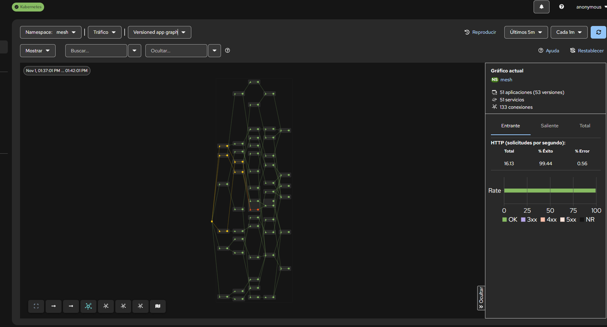
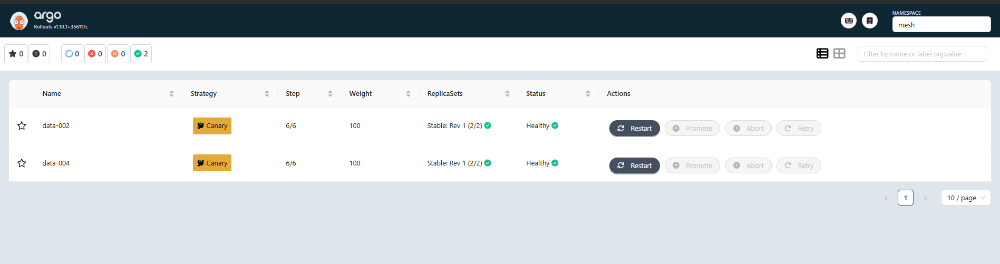
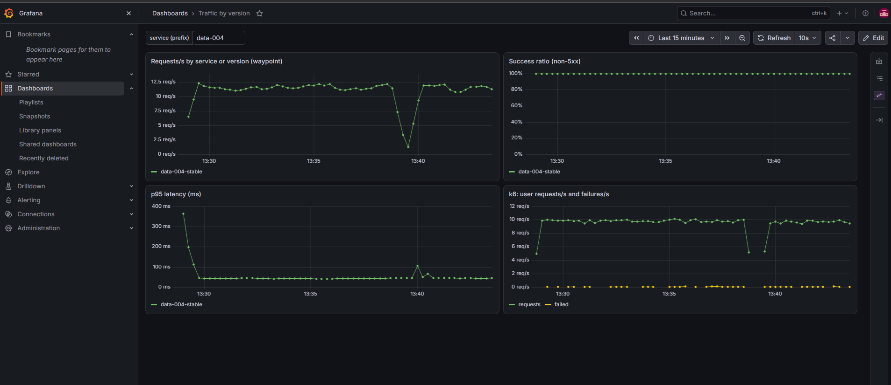
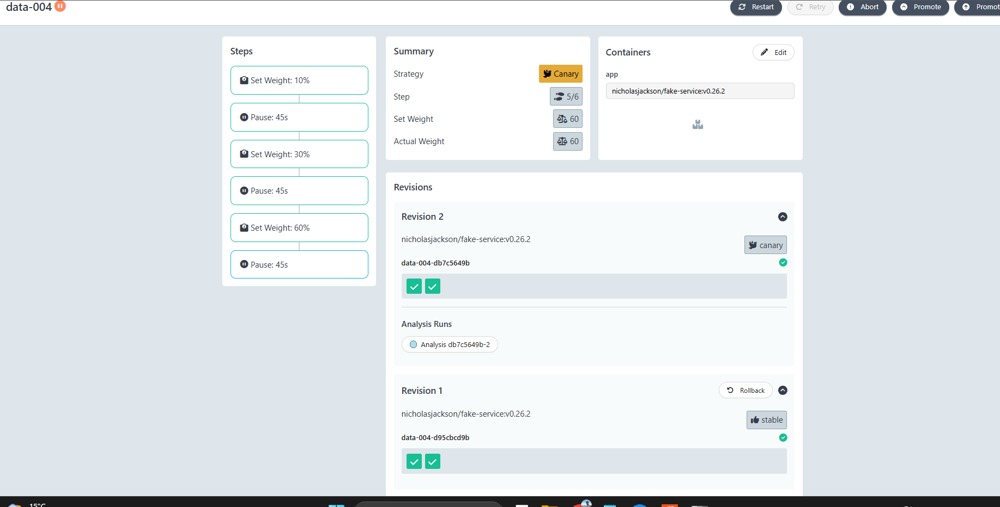
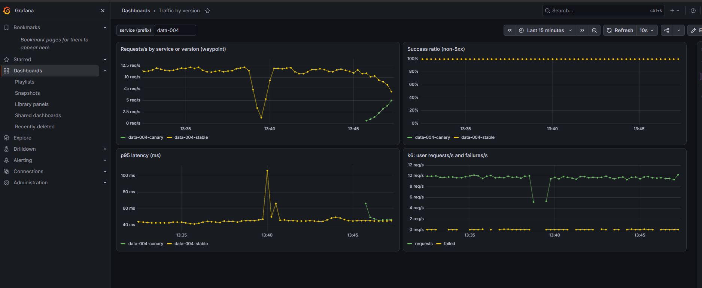
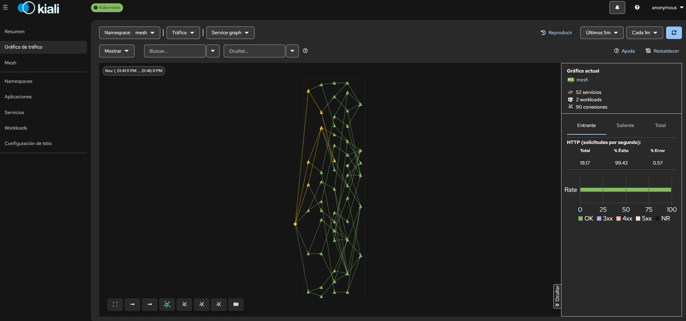
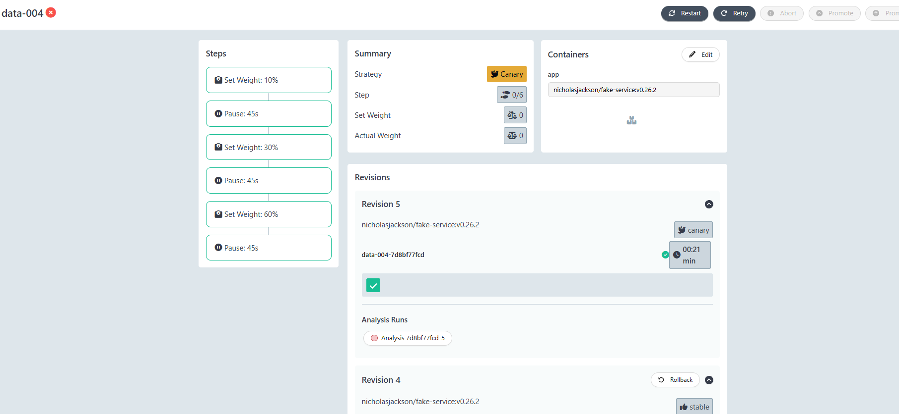
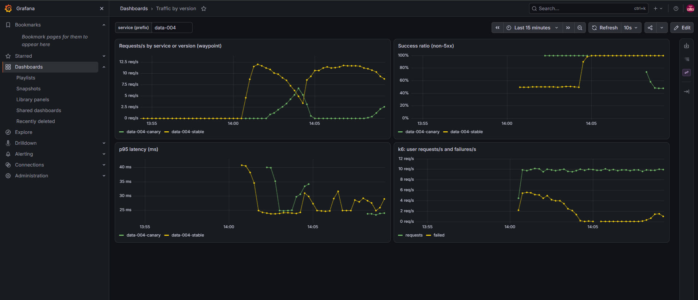

# Informe del laboratorio

Resumen de lo que se montó, lo que se comprobó y los problemas que aparecieron por el camino.
Las capturas son del laboratorio real, ejecutado el 1 de noviembre de 2026.

## 1. Objetivo

Practicar estrategias de despliegue (canary, A/B, mirroring, progressive delivery) y **ver por dónde fluye el tráfico**,
sobre un cluster local con decenas de microservicios sin código propio.

## 2. Arquitectura

```
k6 (en el cluster) ──► fe-001..fe-006 ──► api-* ──► biz-* ──► data-* ──► ext-*
                         todo el tráfico L7 pasa por 1 waypoint (Envoy) en el namespace `mesh`
                                   │
                  Prometheus ◄─────┤ métricas por servicio y versión (istio_requests_total)
                  Kiali      ◄─────┤ grafo de tráfico con % por arista
                  Tempo      ◄─────┘ trazas (fake-service ─Zipkin─► Tempo)
                  Argo Rollouts ──► mueve los pesos del VirtualService y consulta a Prometheus
```

- **Servicios:** una única imagen (`fake-service`) desplegada N veces; el grafo (5 capas, 1-2 upstreams por servicio) lo genera
  `scripts/generate_topology.py` con una semilla fija.
- **Enrutado L7:** Istio en modo ambient, sin sidecars. Un único waypoint para el namespace aplica VirtualServices, pesos y mirroring.
- **Entrega progresiva:** Argo Rollouts con canary 10% → 30% → 60% → 100% y un `AnalysisTemplate` que consulta Prometheus.
- **Carga:** k6-operator ejecuta k6 dentro del cluster (`baseline`, `ramp`, `spike`).

## 3. Entorno donde se validó

| Elemento | Valor |
|---|---|
| Máquina | Windows con WSL2 (Ubuntu 22.04), ~13,9 GB de RAM, 16 hilos |
| Docker Desktop | ~9 GiB asignados a WSL (`.wslconfig`) |
| Cluster | kind v0.24.0, Kubernetes v1.31.0, 1 control-plane + 2 workers |
| Helm | v3.16.2 |
| Argo Rollouts | v1.10.1 (versión que muestra su interfaz) |
| Kiali | v2.34.0 |
| Istio | charts oficiales (`base`, `istiod`, `cni`, `ztunnel`), perfil ambient, versión más reciente disponible en la fecha |
| Gateway API | v1.3.0 |
| Tamaño probado | 50 servicios → 55 pods en el namespace `mesh` |

## 4. Resultados

### 4.1 Línea base: el tráfico fluye y se ve

Con `make load SCENARIO=baseline RATE=10` (10 peticiones de usuario por segundo), Prometheus midió unos **190 req/s internos**
en el waypoint: cada petición de usuario recorre unas 18 llamadas entre servicios, porque fake-service llama a todos sus upstreams.



*Kiali, "Versioned app graph", namespace `mesh`: 51 aplicaciones (53 versiones), 133 conexiones y un 99,44% de éxito.
Las aristas amarillas y la naranja de la izquierda son errores; ver la nota más abajo.*



*Argo Rollouts: los dos servicios con canary (`data-002` y `data-004`) en `Healthy`, paso 6/6, peso 100, revisión 1 estable.*



*Dashboard "Traffic by version" para `data-004`: unos 11-12 req/s, 100% de éxito y p95 de unos 45 ms.
El hueco de las 13:39-13:40 es el cambio entre dos ejecuciones de k6, no un fallo del mesh.
El panel inferior derecho son las métricas de k6 llegando a Prometheus por remote-write.*

**Sobre el 0,56% de errores:** aparece con el laboratorio en reposo. La explicación más probable es el experimento A/B:
`biz-012-v2` inyecta un 10% de errores a propósito y los usuarios del grupo beta (20%) pasan por él, con lo que el error se propaga
hacia arriba por la cadena. No se aisló con una prueba específica.

### 4.2 Canary bueno

`make canary-release SVC=data-004 VERSION=v2 ERR=0.0`. Argo sube el peso por pasos y, en cada uno, un `AnalysisRun` comprueba
cada 15 s que el éxito de la canary sea al menos del 95%.



*`data-004` en el paso 5/6, peso real 60%. Revisión 2 como `canary`, revisión 1 como `stable`, análisis en curso (círculo azul).*



*Aparece la línea `data-004-canary` (verde) y crece mientras `data-004-stable` (amarilla) baja.
La suma se mantiene en unos 12 req/s, el éxito en 100% y la latencia en torno a 45 ms para ambas.*



*Kiali en modo "Service graph" mientras se desplegaba el canary: 52 servicios, 90 conexiones y 99,43% de éxito.*

El canary terminó en 100% y `Healthy`. Todas las mediciones del análisis valieron `[1]` (100% de éxito).

### 4.3 Canary malo: un fallo del propio análisis y su corrección

**Primer intento (falló la validación, no el mesh).** Se lanzó `VERSION=v3 ERR=0.4` justo cuando terminó el test de k6 (duraba 10 min).
Sin tráfico, la query del análisis dividía 0 entre 0 y daba `NaN`, y la condición de éxito original aceptaba `NaN` o resultado vacío.
El análisis aprobó sin haber medido nada y Argo **promovió v3, con un 40% de errores, como versión estable**. Se ve en la captura de Grafana
más abajo: la línea estable se queda en torno al 50% de éxito hasta que se despliega una versión sana.

**Corrección.** La condición pasó a exigir datos (`len(result) > 0 && !isNaN(result[0]) && result[0] >= 0.95`),
con `initialDelay: 30s` y `failureLimit: 3`, y el test `baseline` pasó a durar 30 minutos.

**Segundo intento (correcto).** Se lanzó una versión sana (`v4`) para recuperar el estado y después `VERSION=v5 ERR=0.4`.



*`data-004` en `Degraded` (icono rojo), paso 0/6, peso 0. La revisión 5 (canary) fue abortada por el análisis (círculo rojo)
y la revisión 4 sigue como `stable`. `Degraded` es el estado normal tras un aborto y no afecta al tráfico.*



*Panel "Success ratio": la estable está en ~50% (la v3 mala promovida por error), sube a 100% cuando la v4 sana termina de desplegarse
y, hacia las 14:07, la canary v5 cae a ~48% y el análisis la aborta. El tráfico vuelve a la versión estable sin intervención.*

El éxito de la canary queda cerca del 48% y no del 60% que sugiere el 40% inyectado, porque además hereda los fallos de sus propios upstreams.

## 5. Problemas encontrados y soluciones

| Problema | Causa | Solución |
|---|---|---|
| Docker solo mostraba 6,7 GiB | El `.wslconfig` contenía el comando de PowerShell entero en lugar de solo la configuración | Dejar únicamente `[wsl2]`, `memory`, `processors`, `swap`; cerrar Docker, `wsl --shutdown`, reabrir |
| Distro WSL por defecto `docker-desktop-data` | Es una distro interna de Docker | Instalar Ubuntu y activar su integración en Docker Desktop |
| `kubectl` v1.25 frente a cluster v1.31 | El script de instalación saltó la instalación porque ya había un kubectl (el de Docker Desktop) | Instalar un kubectl actual; comprobar con `which -a kubectl` |
| `make up` falló en k6-operator: *namespace already exists* | El chart crea su propio namespace y chocaba con `--create-namespace` | `--set namespace.create=false` con alternativa de instalar desde `default`; el Makefile incorpora ahora esa corrección |
| Canary malo promovido sin medir | Condición del análisis permisiva con `NaN` y test de k6 ya terminado | Condición estricta, `initialDelay`, `failureLimit: 3` y test de 30 min |
| Tempo: valores del chart inciertos | El chart pasó a `grafana-community/tempo` | Confirmado tras instalar: el servicio expone 9411 (Zipkin) y 3200 |

## 6. Qué se validó y qué no

**Validado en el laboratorio**
- Creación del cluster y de toda la plataforma con `make up` (con el arreglo manual de k6-operator).
- Despliegue de 50 servicios con `make deploy N=50`, el waypoint, y una petición real que atraviesa varias capas.
- Métricas L7 del waypoint en Prometheus (`istio_requests_total` con `reporter="waypoint"` y la etiqueta `destination_service_name`).
- Dashboards: Kiali con el grafo, Grafana con tráfico por versión, y las métricas de k6.
- Canary con Argo Rollouts: promoción de una versión sana y aborto automático de una defectuosa.

**No validado en esta sesión**
- Modos `split` y `mirror` del servicio con variantes, y comprobar el A/B por cabecera aislado.
- Escenarios de k6 `ramp` y `spike`.
- Trazas: Tempo está instalado y recibe por Zipkin en el puerto 9411, pero no se abrió ninguna traza.
- Tamaños de 100 y 150 servicios (se probó 50).
- Feature flags (flagd): no incluidos.

## 7. Siguientes pasos posibles

1. Probar `split`, `mirror` y A/B y documentar los resultados con capturas.
2. Explorar trazas en Grafana (Explore → Tempo) para ver el camino de una petición.
3. Escalar a 100 y 150 servicios vigilando la memoria.
4. Añadir un servicio con código mínimo que consulte flagd para comparar feature flags con canary y A/B.
